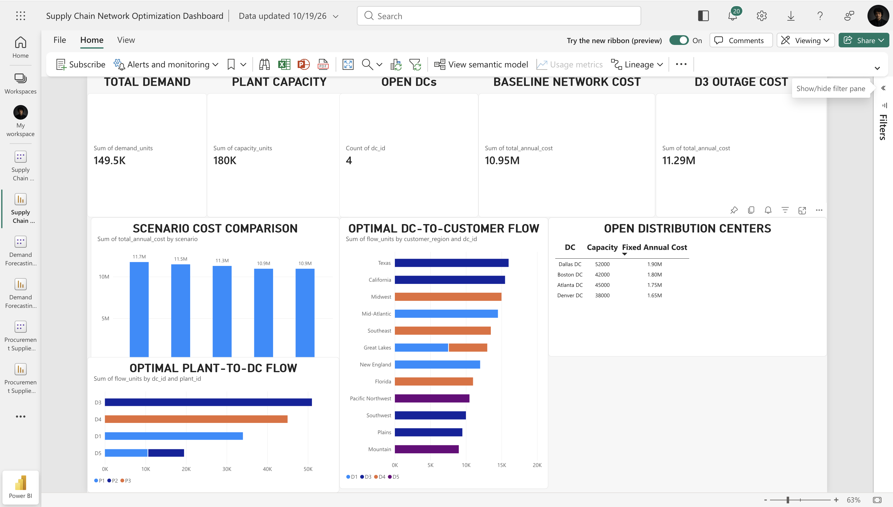

# Supply Chain Network Optimization

An end-to-end supply chain analytics project using **Python, Mixed-Integer Linear Programming, SQL, Excel, and Power BI** to determine the optimal distribution network and evaluate the impact of demand growth, transportation-cost increases, and facility disruptions.

## Business Problem

A manufacturing organization operates multiple plants and must determine how products should flow through a network of candidate distribution centers to customer regions.

The objective is to design a network that:

- Satisfies customer demand
- Respects plant and distribution-center capacity
- Minimizes production, transportation, and facility operating costs
- Identifies which distribution centers should remain operational
- Evaluates network resilience under changing business conditions

---

## Network

The synthetic supply chain consists of:

- **3 manufacturing plants**
- **6 candidate distribution centers**
- **12 customer regions**
- **149.5K units of total customer demand**
- **180K units of total plant capacity**
- Plant-to-DC transportation lanes
- DC-to-customer transportation lanes
- Distribution-center capacity constraints
- Fixed annual DC operating costs
- Plant production costs

> The dataset is synthetic and was developed for portfolio and learning purposes.

---

## Tools & Technologies

- **Python**
- **Pandas**
- **NumPy**
- **SciPy**
- **Mixed-Integer Linear Programming**
- **SQL**
- **Excel**
- **Power BI**

---

## Optimization Model

The network was formulated as a mixed-integer optimization problem.

### Decision Variables

The model determines:

- Quantity shipped from each plant to each distribution center
- Quantity shipped from each distribution center to each customer region
- Whether each candidate distribution center should be opened

### Objective

Minimize total annual network cost including:

- Production cost
- Plant-to-DC transportation cost
- DC-to-customer transportation cost
- Fixed distribution-center operating cost

### Constraints

The model enforces:

- Plant capacity limits
- Distribution-center capacity limits
- Flow balance through each DC
- Full customer-demand satisfaction
- Binary DC open/close decisions

---

## Baseline Optimization Results

The optimized baseline network selected four distribution centers:

- **Boston DC**
- **Dallas DC**
- **Atlanta DC**
- **Denver DC**

Key results:

| KPI | Result |
|---|---:|
| Total Customer Demand | 149.5K units |
| Total Plant Capacity | 180K units |
| Open Distribution Centers | 4 |
| Baseline Annual Network Cost | $10.95M |
| Dallas DC Outage Cost | $11.29M |

### Optimized Plant-to-DC Flow

The baseline solution allocated approximately:

- P1 → Boston DC: **34.0K units**
- P1 → Denver DC: **10.5K units**
- P2 → Dallas DC: **51.0K units**
- P2 → Denver DC: **9.0K units**
- P3 → Atlanta DC: **45.0K units**

Total optimized flow equals total customer demand of **149.5K units**.

---

## Scenario Analysis

The model was rerun under several operating scenarios.

| Scenario | Annual Network Cost | Open DCs |
|---|---:|---|
| Baseline | $10.95M | Boston, Dallas, Atlanta, Denver |
| Demand +15% | $11.75M | Boston, Dallas, Atlanta, Denver |
| Transportation Cost +20% | $11.48M | Boston, Dallas, Atlanta, Denver |
| Dallas DC Outage | $11.29M | Boston, Chicago, Atlanta, Denver |
| Maximum 4 DCs | $10.95M | Boston, Dallas, Atlanta, Denver |

### Key Scenario Findings

- A **15% increase in demand** increased annual network cost to approximately **$11.75M** without changing the optimal DC footprint.
- A **20% increase in transportation cost** increased annual cost to approximately **$11.48M**, while the same four DCs remained optimal.
- A **Dallas DC outage** increased annual network cost to approximately **$11.29M**.
- During the Dallas disruption, the model selected **Chicago DC as the replacement facility**, demonstrating how optimization can support supply-chain resilience planning.
- Limiting the network to four DCs produced the same solution as the baseline, confirming that four facilities were sufficient for the modeled demand and capacity structure.

---

## Power BI Dashboard

The Power BI dashboard summarizes the optimized supply-chain network and scenario results.

It includes:

- Total demand
- Total plant capacity
- Number of open distribution centers
- Baseline network cost
- Dallas outage cost
- Scenario-cost comparison
- Optimized plant-to-DC flows
- Optimized DC-to-customer-region flows
- Open distribution-center capacity and fixed costs



---

## SQL Analysis

The repository also includes SQL queries for:

- Network data-quality checks
- Capacity and demand validation
- Transportation-lane cost analysis

---

## Repository Structure

```text
supply-chain-network-optimization/
│
├── data/
│   ├── raw/
│   │   ├── plants.csv
│   │   ├── distribution_centers.csv
│   │   ├── customer_zones.csv
│   │   ├── plant_to_dc_costs.csv
│   │   └── dc_to_customer_costs.csv
│   │
│   └── processed/
│       ├── optimized_plant_dc_flows.csv
│       ├── optimized_dc_customer_flows.csv
│       ├── open_distribution_centers.csv
│       └── scenario_summary.csv
│
├── notebooks/
│   ├── 01_network_optimization.ipynb
│   └── 02_scenario_analysis.ipynb
│
├── sql/
│   ├── 01_network_data_quality.sql
│   └── 02_lane_cost_analysis.sql
│
├── dashboard/
│   └── screenshots/
│       └── supply_chain_network_optimization_dashboard.png
│
└── README.md
```

---

## Business Recommendations

- Maintain the four-DC baseline configuration under current demand and cost assumptions.
- Monitor Dallas DC as an important node because its disruption requires a network reconfiguration.
- Maintain Chicago as a potential contingency location for network-resilience planning.
- Re-optimize the network when customer demand, transportation rates, facility costs, or capacity constraints materially change.
- Use scenario analysis regularly to evaluate supply-chain resilience rather than relying only on the lowest-cost baseline design.

---

## Project Objective

This project demonstrates how operations research, optimization, scenario analysis, SQL, and business intelligence can be combined to support data-driven supply-chain network design and resilience decisions.
